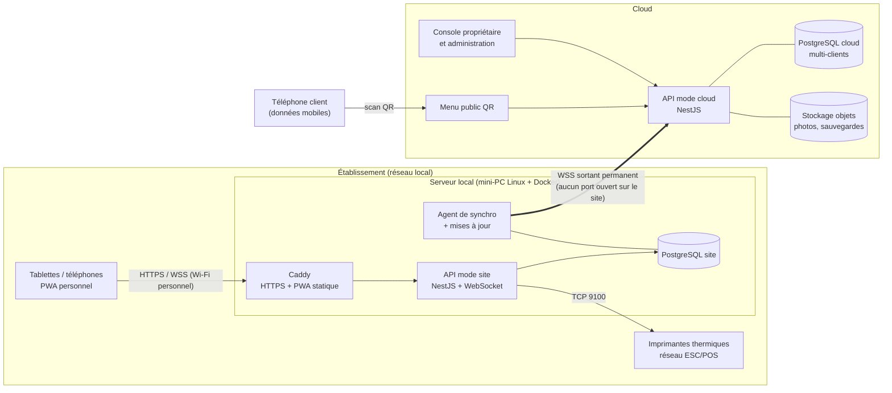

# 1. Vue d'ensemble et déploiement

## Principes directeurs

1. **L'établissement ne dépend jamais d'Internet.** Toute opération courante (commande, cuisine/bar, impression, encaissement, stock, clôture) s'exécute sur le serveur local.
2. **Une seule autorité par donnée.** Le serveur local fait foi pour les opérations de son site ; le cloud fait foi pour le compte client, les licences et les utilisateurs. Aucune donnée n'est modifiée à deux endroits en même temps (voir [Synchronisation](03-synchronisation.md)).
3. **Rien ne s'efface.** Une vente, un paiement ou un mouvement de stock ne se supprime pas ; on le corrige par une écriture inverse, tracée.
4. **Les règles métier vivent sur le serveur.** L'interface n'est qu'un client ; les permissions et les calculs (totaux, stock, écarts) sont toujours vérifiés par l'API.
5. **Un seul code, deux modes.** Le même backend tourne en mode `site` (mini-PC) et en mode `cloud`.

## Topologie



## Composants

| Composant | Rôle | Technologie |
|---|---|---|
| **PWA personnel** (`apps/web`) | Écrans serveur, caisse, cuisine/bar, stocks, gérant, paramètres. Installable sur tablette. | React + Vite, TanStack Query, PWA |
| **Menu public** (`apps/menu`) | Page ouverte par le QR code. Très légère (< 150 Ko JS), bilingue. | React (ou Preact) + Vite |
| **API** (`apps/api`) | Règles métier, permissions, temps réel, impression, synchronisation. Mode `site` ou `cloud`. | NestJS, WebSocket (Socket.IO), Zod |
| **Base de données** | PostgreSQL 17 sur le site et dans le cloud, même schéma. | PostgreSQL + Prisma (migrations) |
| **Agent site** (dans l'API en mode `site`) | Connexion sortante vers le cloud, envoi/réception des événements, mises à jour, sauvegardes. | Module NestJS |
| **Code partagé** (`packages/*`) | Types, schémas de validation, calculs métier, traductions, impression. | TypeScript |

## Organisation du dépôt

```
apps/
  api/            NestJS — modules métier ; MODE=site | cloud
  web/            PWA du personnel
  menu/           Menu public QR
packages/
  shared/         Types, schémas Zod, calculs (totaux, conversions, écarts)
  db/             Schéma Prisma, migrations, données de démo
  i18n/           Traductions FR / EN
  printing/       Génération ESC/POS (tickets, bons, rapport Z)
infra/
  site/           docker-compose du mini-PC, Caddy, dnsmasq, scripts d'installation
  cloud/          déploiement cloud
docs/
```

Gestion : **pnpm workspaces** + **Turborepo**. Node.js 24 LTS.

## Réseau et HTTPS sur le site

Les PWA exigent HTTPS, y compris sur le réseau local. Solution :

1. Chaque site reçoit un nom de domaine dédié, par exemple `akwa-grill.site.tchoplife.app`.
2. Le cloud obtient un certificat Let's Encrypt pour ce nom (défi DNS-01, aucun port ouvert sur le site) et l'envoie au serveur local, qui le renouvelle avant expiration.
3. Le mini-PC a une **IP fixe** (réservation DHCP sur le routeur) et fait tourner **dnsmasq**. Le routeur distribue le mini-PC comme serveur DNS : le nom du site résout vers l'IP locale, même sans Internet. Les autres noms sont transmis normalement.
4. Le Wi-Fi **personnel** et le Wi-Fi **clients** sont séparés. Le serveur local n'est pas joignable depuis le Wi-Fi clients.

> Un certificat Let's Encrypt est valable 90 jours et renouvelé à 60 jours. Une coupure Internet de plusieurs semaines n'interrompt donc pas le service.

## Ce que le site fait avec ou sans Internet

| Fonction | Internet OK | Internet coupé |
|---|---|---|
| Commandes serveur, cuisine/bar, impression | ✓ | ✓ |
| Caisse, reçus, clôture, ardoises | ✓ | ✓ |
| Stocks, recettes, réceptions, inventaires | ✓ | ✓ |
| Connexion du personnel (mot de passe ou PIN) | ✓ | ✓ (comptes répliqués sur le site) |
| Commande par QR code | ✓ | ✗ : le menu reste consultable depuis le cloud, avec un message « appelez un serveur » |
| Rapports à distance (propriétaire) | ✓ | Données arrêtées à la dernière synchro |
| Sauvegarde hors site, mises à jour | ✓ | Reprise automatique au retour d'Internet |

## Limite assumée en V1

Les **tablettes ont besoin du serveur local** (réseau Wi-Fi). Si une tablette perd le Wi-Fi, elle affiche un bandeau et réessaie ; elle ne stocke pas de ventes hors ligne. Le serveur local, lui, est protégé par l'onduleur. Un vrai mode hors ligne par tablette pourra être ajouté plus tard si le terrain le justifie.

## Matériel du serveur local

- Mini-PC x86 : 8 à 16 Go de RAM, SSD 256 Go minimum, Ethernet.
- Ubuntu Server LTS, disque chiffré (LUKS déverrouillé par TPM).
- Onduleur alimentant le mini-PC **et** le routeur, avec arrêt propre en cas de batterie faible.
- Option : disque USB pour une sauvegarde locale supplémentaire.

## Impression

- Imprimantes réseau 80 mm ESC/POS, déclarées dans les paramètres (IP, port 9100, poste : caisse, cuisine, grill, bar).
- L'API place chaque impression dans une **file d'impression** en base (`print_job`), avec plusieurs tentatives et une alerte si une imprimante ne répond plus.
- Toute réimpression est tracée.
