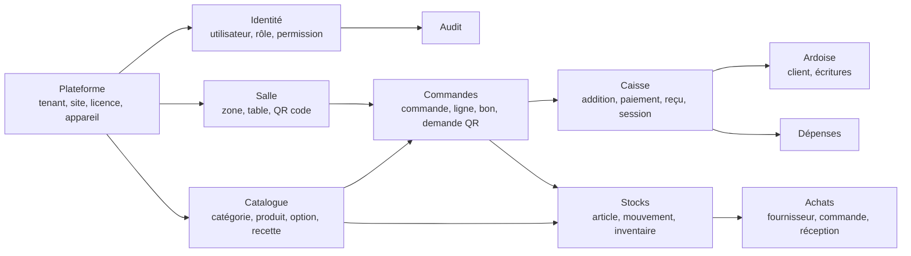
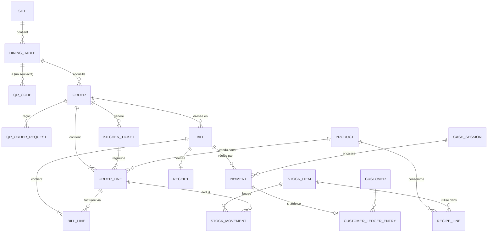

# 2. Modèle de données

## Conventions communes

| Règle | Détail |
|---|---|
| **Identifiants** | `id` en **UUID v7** (triable dans le temps), généré par le serveur qui crée la donnée. Aucun identifiant auto-incrémenté partagé entre site et cloud. |
| **Isolation** | Chaque table métier porte `tenant_id` (client) ; les tables opérationnelles portent aussi `site_id`. |
| **Traçabilité** | `created_at`, `created_by`, `updated_at`, `updated_by`, `version` (entier, verrou optimiste). |
| **Suppression** | Référentiel (produits, tables, fournisseurs…) : désactivation via `archived_at`. Opérations (ventes, paiements, mouvements) : **jamais supprimées**, corrigées par une écriture inverse. |
| **Argent** | Entier en **FCFA** (`bigint`), sans décimales. Les prix sont **TTC** ; la part de taxe est calculée et figée sur chaque ligne. |
| **Quantités de stock** | `numeric(14,3)` dans l'**unité de base** de l'article (bouteille, pièce, g, ml). |
| **Textes traduits** | `jsonb` de la forme `{"fr": "...", "en": "..."}` (nom et description des produits, catégories). |
| **Instantanés** | Une ligne de commande copie le nom, le prix et la taxe au moment de la vente : une modification ultérieure du catalogue ne change pas l'historique. |
| **Numérotation** | Numéros de commande, de bon et de reçu **séquentiels par site**, attribués uniquement par le serveur local (pas de trou, pas de doublon). |

## Vue d'ensemble des domaines

## Cœur du modèle : de la commande au paiement

## Détail des tables

### Plateforme (autorité : cloud)

| Table | Colonnes clés | Remarques |
|---|---|---|
| `tenant` | nom commercial, pays, devise (`XAF`), langue par défaut, statut | Le client qui achète la licence. |
| `subscription` | tenant, offre, nb de sites autorisés, début, fin, statut | Contrôle de la licence ; le site fonctionne 30 jours hors ligne avant avertissement. |
| `site` | tenant, nom, adresse, fuseau, nom de domaine local, paramètres (`jsonb`) | Un établissement. |
| `site_server` | site, empreinte de la clé, version installée, dernier contact | Le mini-PC enregistré. |
| `device` | site, type (tablette, téléphone, PC), nom, jeton (haché), dernier contact, révoqué | Appareils autorisés à se connecter. |
| `printer` | site, nom, IP, port, largeur, poste (caisse/cuisine/grill/bar) | |

### Identité et accès (autorité : cloud, répliqué sur les sites)

| Table | Colonnes clés | Remarques |
|---|---|---|
| `user` | tenant, nom, téléphone, e-mail (facultatif), hash mot de passe, hash PIN, langue, actif | Un employé peut travailler sur plusieurs sites. |
| `role` | tenant, code, nom, système (oui/non) | Rôles prédéfinis + rôles personnalisés plus tard. |
| `role_permission` | role, permission | Liste des permissions : voir [Rôles](05-roles-permissions.md). |
| `user_site_role` | user, site (null = tous les sites), role | Le propriétaire a `site = null`. |
| `auth_session` | user, appareil, émis le, expire le, révoquée | Sessions et jetons de rafraîchissement. |

### Salle (autorité : site)

| Table | Colonnes clés | Remarques |
|---|---|---|
| `zone` | site, nom (Salle, Terrasse, VIP, Comptoir), ordre | |
| `dining_table` | site, zone, libellé, places, position sur le plan, archivée | Ajout et suppression par le gérant. |
| `qr_code` | site, table, **jeton aléatoire** (128 bits), mode (`menu` / `commande`), actif, remplacé le | Un seul QR actif par table ; remplacement = nouveau jeton. |

### Catalogue (autorité : site, modifiable à distance)

| Table | Colonnes clés | Remarques |
|---|---|---|
| `category` | site, nom (FR/EN), ordre, visible au menu QR | |
| `product` | site, catégorie, nom (FR/EN), description (FR/EN), photo, prix TTC, taux de taxe, **poste** (cuisine/grill/bar), disponible, visible QR | Ce qui se vend. |
| `modifier_group` / `modifier` | nom, choix min/max ; libellé, supplément de prix | Options et suppléments (cuisson, accompagnement). |
| `price_schedule` | produit, jours, heure début/fin, prix | Prix par plage horaire (phase 2). |
| `recipe_line` | produit, article de stock, quantité (unité de base), option liée (facultatif) | **Chaque produit vendu a une recette**, y compris les boissons : « Castel 65 cl » = 1 bouteille de l'article Castel. Un seul mécanisme de déduction. |

### Commandes (autorité : site)

| Table | Colonnes clés | Remarques |
|---|---|---|
| `order` | site, n° du jour, table, type (sur place / à emporter / livraison), source (personnel / QR), serveur, statut, ouverte le, fermée le | Statuts : `open` → `billed` → `paid` ; ou `cancelled`. |
| `order_line` | commande, produit, **instantané** (nom, prix, taxe), quantité, options (`jsonb`), note, poste, statut, ticket, annulée (motif, par, approuvée par) | Statuts : `draft` → `sent` → `preparing` → `ready` → `served` ; ou `cancelled`. |
| `kitchen_ticket` | site, commande, poste, n° de bon, statut, imprimé le | Un bon par poste et par envoi. |
| `qr_order_request` | site, table, QR code, contenu (`jsonb`), session client, statut, traité par, motif de refus | Statuts : `pending` → `accepted` / `rejected` / `expired`. Une demande acceptée devient des `order_line`. |
| `print_job` | site, imprimante, type, contenu, statut, tentatives | File d'impression. |

### Caisse (autorité : site)

| Table | Colonnes clés | Remarques |
|---|---|---|
| `cash_register` | site, nom, imprimante | Le poste de caisse. |
| `cash_session` | caisse, caissier, ouverte le, fond initial, fermée le, **théorique par moyen** (`jsonb`), espèces comptées, écart, commentaire, clôturée par | Commentaire obligatoire si écart ≠ 0. |
| `bill` | commande, n°, statut, sous-total, remise, total | Une commande peut avoir plusieurs additions (addition séparée). |
| `bill_line` | addition, ligne de commande, quantité | Permet de répartir une ligne entre plusieurs additions. |
| `discount` | addition ou ligne, type (% / montant), valeur, motif, accordée par, approuvée par | Approbation du gérant au-delà du seuil. |
| `payment` | addition, session de caisse, moyen (`cash`, `mtn_momo`, `orange_money`, `card`, `customer_credit`), montant, montant remis, monnaie rendue, référence, statut | Statuts : `recorded` → `verified` ; ou `voided` (annulation tracée). |
| `receipt` | site, **n° séquentiel**, addition, instantané imprimé (`jsonb`), réimpressions | |
| `refund` | addition, montant, moyen, motif, approuvé par | Avoir ou remboursement. |

### Ardoise client (autorité : site)

| Table | Colonnes clés | Remarques |
|---|---|---|
| `customer` | site, nom, téléphone, plafond de crédit, actif, note | |
| `customer_ledger_entry` | client, type (`charge` / `payment` / `adjustment`), montant, addition, paiement, par, approuvé par | **Solde = somme des écritures**, jamais un champ modifiable à la main. |

### Stocks (autorité : site)

| Table | Colonnes clés | Remarques |
|---|---|---|
| `stock_location` | site, nom (Réserve, Bar, Cuisine, Grill…) | Magasins séparés. |
| `stock_item` | site, nom, unité de base, **magasin de sortie**, seuil d'alerte, **coût moyen pondéré**, actif | Ce qui se stocke (Castel 65 cl, poulet, charbon…). Les ventes sortent du magasin de sortie de l'article (le plantain d'une grillade sort de la cuisine). |
| `stock_packaging` (conversion d'unité) | article, conditionnement d'achat (casier, carton, sac), facteur | Ex. 1 casier Castel = 12 bouteilles. |
| `stock_level` | article, magasin, quantité | **Projection** recalculable à partir des mouvements. |
| `stock_movement` | site, article, magasin, quantité signée, type, motif, document source, par, approuvé par | Types : `receipt`, `sale`, `sale_cancel`, `transfer_out`, `transfer_in`, `loss`, `breakage`, `internal_use`, `inventory_adjustment`. |
| `inventory_count` / `inventory_count_line` | magasin, date, statut ; article, théorique, compté, écart | L'écart génère un mouvement `inventory_adjustment`. |

### Achats (autorité : site)

| Table | Colonnes clés | Remarques |
|---|---|---|
| `supplier` | site, nom, téléphone, contact | |
| `purchase_order` / `purchase_order_line` | fournisseur, statut, date ; article, quantité (unité d'achat), prix | |
| `goods_receipt` / `goods_receipt_line` | commande d'achat, reçue le, justificatif ; article, quantité reçue (unité d'achat), **quantité convertie**, prix | Génère les mouvements `receipt` et met à jour le coût moyen. |

### Dépenses (autorité : site)

| Table | Colonnes clés | Remarques |
|---|---|---|
| `expense_category` | site, nom, nature (`operating` charge / `purchase` achat de marchandises) | Approvisionnement (achat), transport, énergie, entretien, salaires, loyer, divers. |
| `expense` | site, n°, catégorie, jour, montant, moyen, session de caisse (si payée depuis la caisse), description, référence, justificatif, statut, par, approuvé par, annulation (par, motif) | Une dépense payée en espèces depuis la caisse sort du théorique de clôture. Jamais supprimée : annulée avec motif. |

### Audit et synchronisation

| Table | Colonnes clés | Remarques |
|---|---|---|
| `audit_log` | site, acteur, approbateur, action, entité, id, avant (`jsonb`), après (`jsonb`), motif, appareil, date | **Ajout seul.** Le rôle base de données de l'application n'a ni `UPDATE` ni `DELETE` sur cette table. |
| `outbox_event` | site, **n° de séquence**, type, entité, id, contenu, créé le, envoyé le | Voir [Synchronisation](03-synchronisation.md). |
| `inbox_command` | site, id, type, contenu, reçu le, appliqué le, résultat | Commandes reçues du cloud. |

## Règles de calcul clés

- **Total d'une addition** = Σ(quantité × prix instantané des lignes) − remises. Calculé par `packages/shared`, utilisé à l'identique par l'API et l'interface.
- **Déduction de stock** : au passage d'une ligne à l'état `sent`, l'API crée un mouvement `sale` pour chaque ligne de recette du produit (et des options choisies).
- **Annulation après envoi** : motif obligatoire ; le stock est **réintégré** (`sale_cancel`, ex. bière non ouverte) par défaut si la préparation n'avait pas commencé, sinon **compté en perte** (`sale_cancel` + `loss`, plat déjà préparé). La personne qui annule peut changer ce choix ; il est tracé dans le journal.
- **Stock négatif** : autorisé par défaut, avec alerte. Une vente n'est jamais bloquée à cause d'une erreur de stock ; l'écart remonte à l'inventaire.
- **Coût moyen pondéré** : recalculé à chaque réception, `(stock × coût + reçu × prix) / (stock + reçu)`.
- **Clôture** : théorique espèces = fond initial + Σ `payment.montant` en espèces (montant imputé, monnaie déjà déduite) − remboursements en espèces − dépenses payées depuis la caisse.
