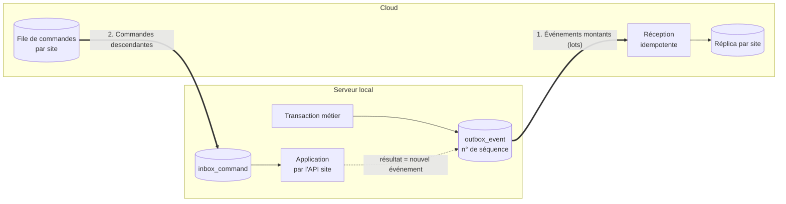
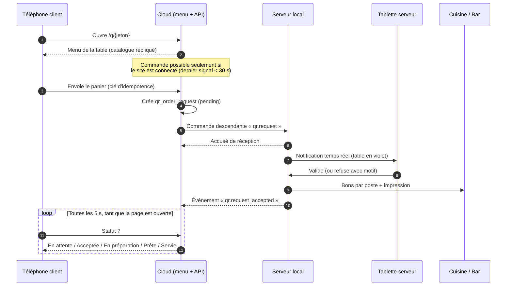

# 3. Synchronisation site ↔ cloud

## Le principe : une seule autorité par donnée

Plutôt que de résoudre des conflits après coup, on les **évite** : chaque donnée a un seul « propriétaire » qui l'écrit. Les autres en ont une copie en lecture.

| Données | Autorité | Le cloud | Le site |
|---|---|---|---|
| Opérations : commandes, bons, additions, paiements, reçus, sessions de caisse, ardoises, mouvements de stock, réceptions, dépenses, audit | **Site** | Copie en lecture (rapports, sauvegarde) | Écrit |
| Référentiel du site : catalogue, prix, recettes, tables, QR codes, fournisseurs, paramètres | **Site** | Peut **demander** une modification (commande à distance) | Écrit et applique les demandes |
| Compte : client, licence, sites, utilisateurs, rôles, appareils | **Cloud** | Écrit | Copie en lecture (pour la connexion hors ligne) |
| Demandes de commande QR | **Cloud** à la réception, puis **site** après transmission | Reçoit et relaie | Valide ou refuse |

Conséquence : **pas de conflit d'écriture possible** sur les opérations. Les seuls conflits concernent les modifications du référentiel faites à distance, et ils sont tranchés par le site (voir plus bas).

## Les deux flux

### 1. Flux montant : site → cloud (événements)

1. Chaque transaction métier écrit ses données **et** un `outbox_event` **dans la même transaction PostgreSQL** (modèle « transactional outbox »). Impossible d'avoir une vente enregistrée sans son événement, ou l'inverse.
2. Chaque événement porte un **n° de séquence** strictement croissant par site, un `id` UUID v7, un type (`order.line_added`, `payment.recorded`, `stock.movement_created`…) et l'état complet de l'entité concernée.
3. L'agent de synchro envoie les événements **par lots** (ex. 500) sur la connexion WebSocket sortante, dans l'ordre des séquences.
4. Le cloud applique chaque lot dans une transaction : **upsert** par `(tenant_id, site_id, id)`, puis enregistre la dernière séquence reçue. Un événement déjà reçu est ignoré (**idempotence**), donc renvoyer un lot est sans risque.
5. Le cloud répond avec la dernière séquence acceptée ; le site marque les événements comme envoyés.
6. Si le cloud détecte un **trou** dans les séquences, il demande au site de renvoyer à partir de la séquence manquante.

Après une coupure, l'agent rattrape le retard automatiquement. Une semaine d'activité représente quelques dizaines de milliers d'événements, soit quelques minutes d'envoi.

### 2. Flux descendant : cloud → site (commandes)

Utilisé pour :
- les **modifications à distance** du référentiel (le propriétaire change un prix depuis chez lui) ;
- les changements de **comptes et rôles** (nouvel employé, révocation) ;
- la **licence**, les certificats HTTPS, les **mises à jour** ;
- les **demandes de commande QR**.

Fonctionnement :
1. Le cloud place la commande dans une file propre au site, avec un `id` unique.
2. Dès que le site est connecté, il la reçoit, l'enregistre dans `inbox_command` (idempotent), l'applique **avec les mêmes règles que si elle avait été faite sur place** (permissions, validations, audit), puis accuse réception.
3. Le résultat (ex. le produit modifié) remonte par le flux montant comme n'importe quel événement. Le cloud n'affiche donc jamais un état « deviné » : il montre l'état confirmé par le site, ou « en attente d'application ».

### Conflits sur le référentiel

Chaque enregistrement du référentiel a un champ `version`. Une modification à distance envoie la version qu'elle a vue :
- **même version** → appliquée ;
- **version différente** (quelqu'un a modifié la même fiche sur place entre-temps) → **refusée**, et le propriétaire voit « La fiche a été modifiée sur place, rechargez-la ». Pas de fusion silencieuse.

## Parcours d'une commande QR

Règles :
- Si le site **n'a pas donné signe de vie** depuis 30 secondes, le menu passe en **consultation seule** et affiche « appelez un serveur ».
- Une demande restée sans réponse pendant **10 minutes** expire (`expired`), et le client en est informé.
- Une demande transmise au site mais pas encore acquittée est renvoyée automatiquement (le site ignore les doublons grâce à l'`id`).

## Horloge et numérotation

- L'**heure qui fait foi** est celle du serveur local (synchronisée par NTP quand Internet est disponible). Les tablettes n'horodatent rien elles-mêmes.
- Les numéros de commande, de bon et de reçu sont attribués **uniquement par le serveur local**, par des séquences PostgreSQL du site. Pas de trou, pas de doublon, même hors ligne.

## Tablettes ↔ serveur local

- Toutes les écritures passent par l'API du site. Chaque requête porte une **clé d'idempotence** générée par la tablette. Si le Wi-Fi coupe au mauvais moment et que la tablette réessaie, la commande ou le paiement **n'est pas enregistré deux fois**.
- Les mises à jour en temps réel (nouvelle commande, bon prêt, addition demandée) arrivent par WebSocket. À la reconnexion, la tablette recharge l'état courant.

## Sauvegardes

| Où | Quoi | Fréquence | Conservation |
|---|---|---|---|
| Serveur local | `pg_dump` chiffré | Toutes les nuits + avant chaque mise à jour | 14 jours |
| Disque USB (option) | Copie de la sauvegarde locale | Toutes les nuits | 7 jours |
| Cloud | Réplica continu (flux montant) + sauvegarde chiffrée du site | Continu / toutes les nuits | 30 jours |
| Cloud | Sauvegarde de la base cloud | Toutes les nuits + journaux continus | 30 jours |

**Restauration d'un site** (mini-PC volé ou en panne) : installer un nouveau mini-PC, l'enregistrer avec un code d'activation, et il récupère la dernière sauvegarde du cloud. Cette procédure sera **testée avant le lancement pilote** (critère de réception « Sauvegarde » du cahier des charges).

## Supervision

Le cloud alerte le support et le propriétaire si :
- un site est **hors ligne** depuis plus d'une heure en horaires d'ouverture ;
- le **retard de synchro** dépasse 1 000 événements alors que le site est en ligne ;
- une **sauvegarde** a échoué ;
- le **disque** du mini-PC dépasse 80 % ;
- une **imprimante** ne répond plus.
