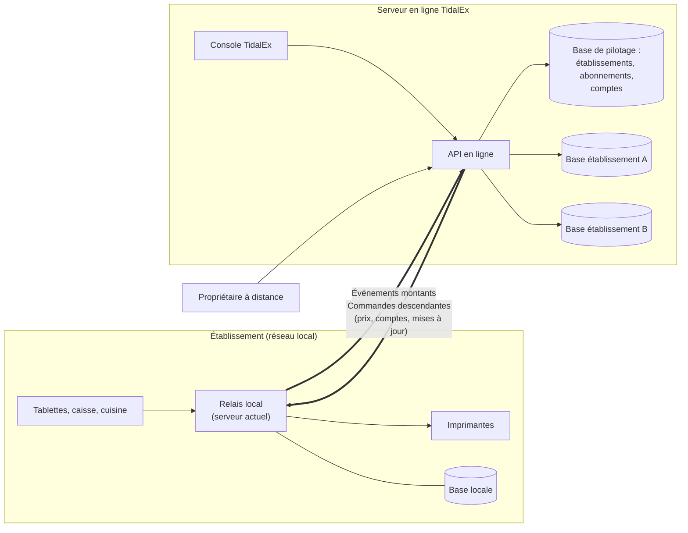

# 6. TidalEx Resto en ligne : plan de réalisation

Objectif : proposer TidalEx Resto à d'autres établissements, **hébergé en ligne** par TidalEx, tout en **continuant de fonctionner pendant une coupure d'Internet**, avec une **base de données neuve et séparée pour chaque établissement**. Les données faites hors ligne partent toutes seules vers le serveur en ligne au retour de la connexion.

Ce plan applique la synchronisation décrite en [3. Synchronisation site ↔ cloud](03-synchronisation.md), qui reste la référence.

## Ce que voit chaque acteur

| Acteur | Où il se connecte | Pendant une coupure d'Internet |
|---|---|---|
| Serveurs, cuisine, bar, caisse | Le **relais local** (l'ordinateur de caisse), par le Wi-Fi du personnel | Rien ne change : commandes, bons, impressions et caisse continuent |
| Propriétaire, gérant à distance | Le **serveur en ligne**, depuis un téléphone ou un ordinateur | Il voit les données jusqu'à la coupure ; le reste arrive au retour de la connexion |
| TidalEx | La **console d'administration** en ligne | Il voit quels établissements sont déconnectés et depuis quand |

## Pourquoi un relais local

Sans Internet, les appareils de la salle ne peuvent plus joindre le serveur en ligne. Un navigateur ne peut ni parler directement à une autre tablette, ni imprimer sur une imprimante réseau. Pour que la commande d'un serveur arrive en cuisine et que les bons s'impriment pendant une coupure, un ordinateur sur place doit faire le relais : c'est l'ordinateur de caisse, qui fait déjà ce travail aujourd'hui.

## Architecture cible

- **Une base par établissement** sur le serveur en ligne : isolation complète, sauvegarde, export ou suppression établissement par établissement. Une petite **base de pilotage** liste les établissements, leur base, leur abonnement et leur relais.
- **Le relais local reste l'autorité** pour les opérations (commandes, paiements, reçus, stock) : un seul endroit écrit, donc aucun conflit à résoudre. Le serveur en ligne en garde une copie à jour.
- **Les modifications faites à distance** (un prix, un nouvel employé) passent par le serveur en ligne, puis sont appliquées par le relais avec les mêmes contrôles que sur place.
- **La numérotation** (reçus, commandes) reste attribuée par le relais : elle ne peut donc pas se dédoubler pendant une coupure.

## Étapes

Chaque étape est livrée, testée et mise en service avant la suivante. Le serveur de TCHOP LIFE continue de fonctionner tel quel pendant toute la réalisation.

| Étape | Contenu | Résultat visible |
|---|---|---|
| **1. Plateforme en ligne** (faite, v1.1.0 : [Serveur en ligne](../hebergement-en-ligne.md)) | Serveur hébergé (Ubuntu, Caddy, PostgreSQL, sauvegardes), base de pilotage, commande « nouvel établissement » qui crée une base vide, applique les tables, crée le compte propriétaire et un code d'activation | Un nouvel établissement est créé en ligne en une commande |
| **2. File d'attente locale** | Sur le relais, chaque opération écrit aussi un événement numéroté dans la même transaction (modèle « outbox ») | Rien ne se perd entre deux synchronisations |
| **3. Synchronisation montante** | Envoi des événements par lots sur la connexion sécurisée existante, réception idempotente, reprise après coupure, détection des trous | Le serveur en ligne a une copie à jour ; elle se rattrape seule au retour d'Internet |
| **4. Accès à distance par le serveur en ligne** | Tableau de bord, rapports, caisse et stock en lecture depuis le serveur en ligne | Le propriétaire suit son établissement de partout, sans Tailscale |
| **5. Commandes descendantes** | Modifications de la carte, des prix, des comptes et des tables depuis le serveur en ligne, appliquées par le relais | Le propriétaire change un prix depuis chez lui |
| **6. Installation simplifiée** | Script d'installation du relais avec le code d'activation : il récupère la base de l'établissement, la carte et les comptes | Nouvel établissement installé en une heure |
| **7. Console TidalEx** | Liste des établissements, état de connexion, version, abonnement, sauvegardes | TidalEx surveille tous ses clients d'un coup d'œil |

## Points à décider avant l'étape 1

- **Hébergeur et taille du serveur** : un serveur virtuel (VPS) suffit pour démarrer ; à choisir selon le prix, la proximité et les garanties de sauvegarde.
- **Nom de domaine** : nécessaire pour l'accès en ligne avec un certificat reconnu partout (par exemple `app.tidalex.cm`).
- **Obligations légales** : vérifier les règles applicables à l'hébergement des données des clients (déclaration, lieu d'hébergement, contrat de sous-traitance des données).
- **Abonnement impayé** : ce que le serveur en ligne cesse de fournir (accès à distance, mises à jour) sans jamais bloquer la caisse de l'établissement.

## Sécurité

- Chaque relais a son propre secret ; un relais ne voit et n'écrit que la base de son établissement.
- Les connexions sont toujours sortantes depuis l'établissement : aucun port à ouvrir sur le routeur.
- Les comptes et les mots de passe restent hachés ; les PIN ne quittent jamais l'établissement en clair.
- Chaque base d'établissement est sauvegardée séparément, chaque jour, avec un test de restauration régulier.
